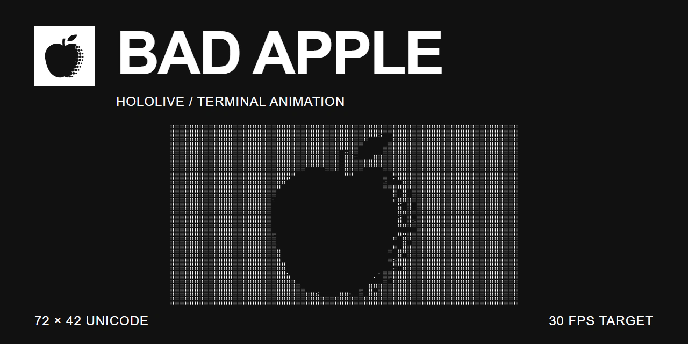

# Bad Apple Hololive Terminal Animation



Bad Apple Hololive Terminal Animation plays a pre-rendered sequence of Unicode Braille text frames in a Windows console. The repository includes 6,545 frames at 72 × 42 characters, ordered for playback at a target rate of 30 FPS.

At that rate, the included sequence runs for approximately 3 minutes and 38 seconds. `ascii.py` can rebuild the text frames from a separate numbered image sequence when needed.

## Included frames

- `assets/text` contains `1.txt` through `6545.txt` with no gaps.
- Each frame contains 42 rows of 72 Unicode Braille or block characters.
- `main.py` reads the files in numeric order and redraws the console for each frame.
- The player waits for a keypress before starting.

## Play the animation

Run the player from the repository root:

```bash
python main.py
```

Press any key when prompted to begin playback. Press `Ctrl+C` to stop.

## Rebuild the text frames

Frame conversion is optional because the generated text sequence is already available in `assets/text`.

Install the converter dependencies from the repository root:

```bash
python -m pip install -r requirements.txt
```

Create `assets/images`, then place the source frames in that directory:

```bash
mkdir -p assets/images
```

Every file in `assets/images` must have a numeric filename stem, such as `1.png`, `2.png`, or `3.jpg`. Use RGB or RGBA images; the converter does not change the image mode before reading pixel values.

Run the converter in Python's UTF-8 mode:

```bash
python -X utf8 ascii.py
```

`ascii.py` sorts the source images numerically, resizes each frame to 72 × 42 pixels with nearest-neighbor scaling, maps pixel luminance to an 11-character Unicode density scale, and writes the result to `assets/text`.

## Source material and attribution

The included text frames were generated from image frames based on the following reference material:

| Material | Source |
| --- | --- |
| Hololive reference video | [【Hololive】BAD APPLE!! PV（影絵 Hololive Version）](https://youtu.be/xzSJwd_MZ_k), created by まふゆ |
| Original shadow-art PV | [【東方】Bad Apple!! PV【影絵】](https://www.nicovideo.jp/watch/sm8628149), animated by あにら (Anira) |
| YouTube copy cited by the Hololive video | [Bad Apple!! shadow-art PV](https://youtu.be/FtutLA63Cp8) |
| Music | “Bad Apple!! feat. nomico” by Alstroemeria Records: original composition by ZUN, arrangement by Masayoshi Minoshima, lyrics by Haruka, and vocals by nomico. See the [official music credits](https://danmaku.jp/archive/music/m018/). |
| Hololive models, props, effects, and scene assets | Credited to their respective creators in the Hololive reference video's description. |
| Text frames | The 6,545 files in `assets/text` were generated from frames extracted from the Hololive reference video. |

The repository includes the derived text frames, but not the video, audio, extracted source images, MMD models, props, effects, or scene files. The reference video's description remains the source for the complete model and asset credits.

## Known limitations

- Playback depends on the Windows `pause` and `cls` commands.
- Audio playback and synchronization are not implemented.
- The 72 × 42 output size and character set are fixed in `ascii.py`.
- Console clearing, file access, and rendering time can reduce the effective frame rate below 30 FPS.
- The player does not loop and does not provide playback controls beyond interruption with `Ctrl+C`.
- Image filenames and generated text filenames must have numeric stems.